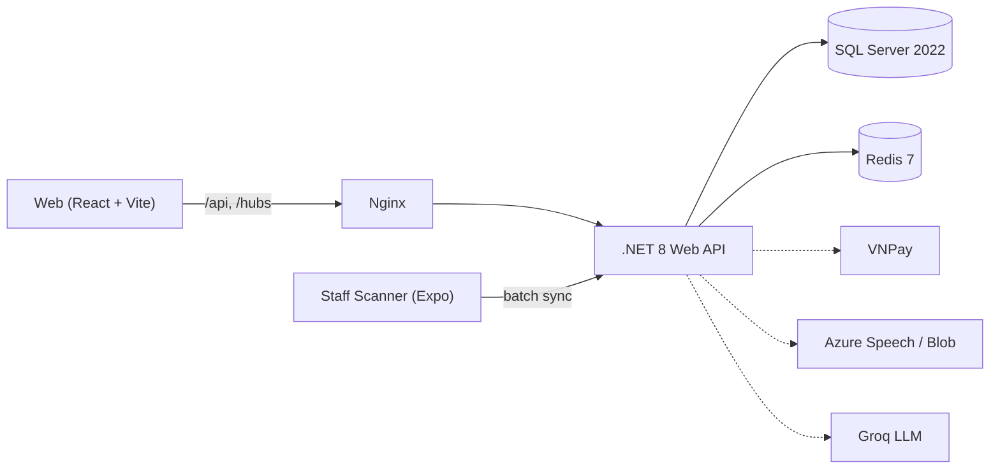
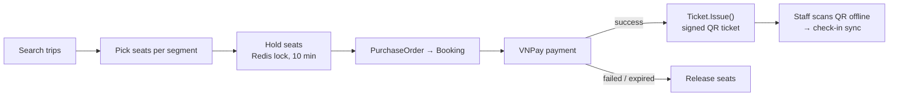

[🇻🇳 Tiếng Việt](README.vi.md) · **🇬🇧 English**

# Smart Waterbus

A ticketing system for **Saigon river buses and cruises** (PRN232 course project). Passengers pick seats per journey segment, pay with VNPay and receive digitally signed QR tickets. Station staff scan tickets offline on a mobile app, while Admins and Captains follow the fleet in real time.

[](https://github.com/minhvuong0909/waterbus-system/actions/workflows/ci.yml)


## Table of contents

- [Features](#features)
- [Architecture](#architecture)
- [Quick start with Docker](#quick-start-with-docker)
- [Running each part for development](#running-each-part-for-development)
- [Core business flow](#core-business-flow)
- [Repository layout](#repository-layout)
- [Team](#team)
- [Documentation](#documentation)
- [Contributing](#contributing)

## Features

| Module | Audience | What it does |
|---|---|---|
| **Customer portal** (Web) | Passenger, Guest | Trip search, route map, per-segment seat selection, VNPay payment, QR ticket wallet. Guests need no account and use a secure link |
| **Admin portal** (Web) | Admin | Routes, schedules, trips, boats, fares, revenue, refunds, personnel, incidents, live fleet radar |
| **Captain portal** (Web) | Captain | Own trips, incident and SOS reports, onboard audio control |
| **Staff Scanner** (Mobile) | Staff | **Offline** QR verification with a public key, batched check-in sync |
| **AI & Audio** | Passenger | AI trip-search assistant, automatic landmark narration driven by boat position (geofence + Azure TTS) |

Five actors: **Passenger, Guest, Admin, Staff, Captain** (there is no Dispatcher).

## Architecture



The backend follows Clean Architecture. Every feature uses the same flow:

```text
Controller → I{Feature}Service → Service → I{Feature}Repository → Repository → EF Core
```

Double-booking is prevented by two layers: a **Redis lock** (10-minute TTL) and EF Core **RowVersion**. Seats are held per **segment** (the `VisitOrder` of `TripStopCall`).

## Quick start with Docker

Requires Docker Desktop.

```bash
cp .env.example .env        # set MSSQL_SA_PASSWORD, REDIS_PASSWORD, JWT_SECRET (>= 32 chars)
docker compose up -d --build
```

| Service | URL |
|---|---|
| Web | http://localhost:8080 |
| Swagger (only when `ASPNETCORE_ENVIRONMENT=Development`) | http://localhost:5000/swagger |
| Hangfire dashboard (Admin only) | http://localhost:5000/hangfire |

- **Sample data:** only `ASPNETCORE_ENVIRONMENT=Development` seeds accounts and sample data (Admin, Captain, Staff, routes, trips). Production seeds nothing.
- **Onboard audio demo:** `docker compose -f docker-compose.yml -f docker-compose.demo.yml up -d --build` (see [docs/DEMO_AUDIO.md](docs/DEMO_AUDIO.md)).
- **Local email testing:** `docker compose --profile mail-dev up -d` (Mailpit at http://127.0.0.1:8025).

> **Changed `MSSQL_SA_PASSWORD` after the first run?** SQL Server only reads the password when the volume is first initialised, so the container turns `unhealthy` (`Login failed for user 'sa'`). Run `docker compose down -v` (this wipes the database), then `up` again.

## Running each part for development

Start only the infrastructure in Docker and run the code by hand:

```bash
docker compose up -d sqlserver redis
```

**Backend** (.NET 8 SDK). Keep secrets in `dotnet user-secrets` or environment variables; see `appsettings.example.json`:

```bash
cd waterbus-be
dotnet build WaterbusSystem.sln
dotnet test WaterbusSystem.sln
dotnet run --project src/WaterbusSystem.WebApi      # API on :5000
```

**Frontend** (Node 20 + pnpm). Vite proxies `/api` and `/hubs` to `127.0.0.1:5000`:

```bash
cd waterbus-fe
pnpm install --frozen-lockfile
pnpm dev                                            # http://localhost:5173
pnpm lint && pnpm test && pnpm build                # before opening a PR
```

**Mobile Scanner** (Expo):

```bash
cd waterbus-mobile/myApp
pnpm install
pnpm dev                                            # Metro bundler
pnpm test:scanner                                   # offline scanning checks
```

Tests that need a real SQL Server read `WATERBUS_TEST_SQLSERVER` (they create and drop `WaterbusDomainTests_*` databases themselves).

## Core business flow



Key rules:

- **Tickets are issued only after a successful payment** (`Ticket.Issue()`).
- Payments and refunds share `FinancialTransaction`; every transaction carries an `IdempotencyKey`.
- **An incident never changes trip status by itself.** The Captain reports an Incident or SOS, the Admin decides through `IncidentTrip.OperationDecision`, and every `Trip.Status` change writes a `TripOperationEvent`.
- Real time runs on SignalR: `/hubs/seat-sync` and `/hubs/boat-tracking` (see [REALTIME_CONTRACT](docs/REALTIME_CONTRACT.md)).

## Repository layout

```text
WaterbusSystem/
├── waterbus-be/        # .NET 8 backend (Domain, Application, Infrastructure, WebApi) + tests
├── waterbus-fe/        # React + Vite + TypeScript web app (Customer/Guest, Admin, Captain)
├── waterbus-mobile/    # Staff Scanner app (Expo / React Native)
├── docs/               # Business rules, API contracts, technical docs
├── tools/              # Helper tools (audio)
├── docker-compose.yml  # Whole system: SQL Server, Redis, API, Web
├── AGENTS.md           # Mandatory rules for AI coding agents and developers
└── .env.example        # Environment template (never commit .env)
```

## Team

| Member | Responsibility |
|---|---|
| **Vương** | Team lead, Core Backend: BR v2.0 rules, trip search, per-segment seat map |
| **Nhật Anh** | Commercial Backend: checkout, Redis seat hold, VNPay, refunds, QR signing |
| **Kiệt** | Real time, background jobs, DevOps: SignalR, Hangfire, Docker, CI |
| **Viễn** | Web frontend: customer portal, Admin, Captain, map radar |
| **Tuấn** | Staff Scanner mobile: offline QR, SQLite, batch sync |
| **Thịnh** | AI and sightseeing audio: trip assistant, POI geofence, Azure TTS |

## Documentation

Start at [docs/README.md](docs/README.md) (technical docs are written in Vietnamese). The most important files:

- [Business Rules v2.0](docs/Smart_Waterbus_Business_Rules_v2_0_FINAL_2026-09-29.md): the source of truth for business behaviour; it **wins over every other document** on conflict.
- [AGENTS.md](AGENTS.md) and [docs/CONVENTIONS.md](docs/CONVENTIONS.md): coding rules, read them before changing code.
- [docs/KNOWN_ISSUES.md](docs/KNOWN_ISSUES.md): open issues and cross-module items.

## Contributing

- Never push straight to `main`. Use `feature/<name>-<topic>`, `fix/...` or `docs/...` branches and Conventional Commits.
- Each PR needs a green build and tests, and at least one review.
- Never commit secrets (`.env`, JWT secret, VNPay secret, passwords).
