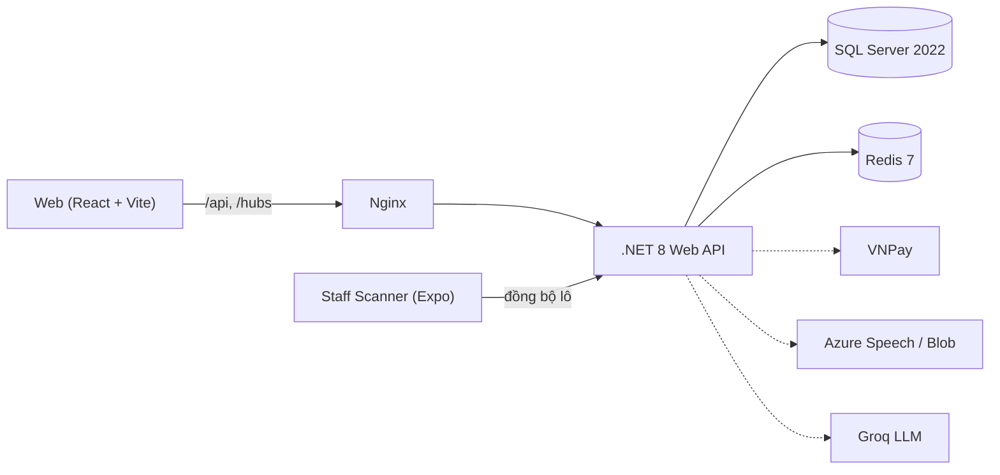
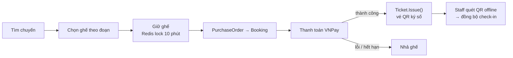

**🇻🇳 Tiếng Việt** · [🇬🇧 English](README.md)

# Smart Waterbus

Hệ thống đặt vé **tàu buýt đường sông và du thuyền Sài Gòn** (môn PRN232). Khách chọn ghế theo từng đoạn hành trình, thanh toán VNPay và nhận vé QR ký số. Nhân viên bến soát vé offline bằng app mobile, Admin và Thuyền trưởng theo dõi tàu theo thời gian thực.

[](https://github.com/minhvuong0909/waterbus-system/actions/workflows/ci.yml)


## Mục lục

- [Tính năng](#tính-năng)
- [Kiến trúc](#kiến-trúc)
- [Chạy nhanh với Docker](#chạy-nhanh-với-docker)
- [Chạy từng phần khi phát triển](#chạy-từng-phần-khi-phát-triển)
- [Luồng nghiệp vụ chính](#luồng-nghiệp-vụ-chính)
- [Cấu trúc thư mục](#cấu-trúc-thư-mục)
- [Nhóm thực hiện](#nhóm-thực-hiện)
- [Tài liệu](#tài-liệu)

## Tính năng

| Phân hệ | Dành cho | Nội dung |
|---|---|---|
| **Cổng khách** (Web) | Passenger, Guest | Tìm chuyến, bản đồ tuyến, chọn ghế theo đoạn, thanh toán VNPay, ví vé QR. Guest không cần đăng nhập, truy cập bằng liên kết bảo mật |
| **Quản trị** (Web) | Admin | Tuyến, lịch, chuyến, tàu, giá vé, doanh thu, hoàn tiền, nhân sự, sự cố, radar vị trí đội tàu |
| **Thuyền trưởng** (Web) | Captain | Chuyến của tàu mình, báo cáo sự cố và SOS, điều khiển audio trên tàu |
| **Staff Scanner** (Mobile) | Staff | Quét QR **offline** bằng Public Key, đồng bộ check-in theo lô |
| **AI & Audio** | Passenger | Trợ lý AI tìm chuyến, thuyết minh địa danh tự động theo vị trí tàu (geofence + Azure TTS) |

5 actor: **Passenger, Guest, Admin, Staff, Captain** (không có Dispatcher).

## Kiến trúc



Backend theo Clean Architecture, mỗi tính năng dùng cùng một luồng:

```text
Controller → I{Feature}Service → Service → I{Feature}Repository → Repository → EF Core
```

Chống đặt trùng ghế 2 lớp: **Redis lock** (TTL 10 phút) và **RowVersion** của EF Core. Ghế được giữ theo **đoạn** (`VisitOrder` của `TripStopCall`).

## Chạy nhanh với Docker

Yêu cầu: Docker Desktop.

```bash
cp .env.example .env        # điền MSSQL_SA_PASSWORD, REDIS_PASSWORD, JWT_SECRET (>= 32 ký tự)
docker compose up -d --build
```

| Dịch vụ | Địa chỉ |
|---|---|
| Web | http://localhost:8080 |
| Swagger (chỉ khi `ASPNETCORE_ENVIRONMENT=Development`) | http://localhost:5000/swagger |
| Hangfire Dashboard (chỉ Admin) | http://localhost:5000/hangfire |

- **Dữ liệu mẫu:** `ASPNETCORE_ENVIRONMENT=Development` mới seed tài khoản và dữ liệu mẫu (Admin, Captain, Staff, tuyến, chuyến). Production thì không seed.
- **Demo audio trên tàu:** `docker compose -f docker-compose.yml -f docker-compose.demo.yml up -d --build` (xem [docs/DEMO_AUDIO.md](docs/DEMO_AUDIO.md)).
- **Thử email local:** `docker compose --profile mail-dev up -d` (Mailpit ở http://127.0.0.1:8025).

> **Đổi `MSSQL_SA_PASSWORD` sau khi đã chạy?** SQL Server chỉ đọc mật khẩu ở lần khởi tạo đầu. Container sẽ `unhealthy` (`Login failed for user 'sa'`). Chạy `docker compose down -v` (xoá dữ liệu DB) rồi `up` lại.

## Chạy từng phần khi phát triển

Chỉ bật hạ tầng bằng Docker, chạy code bằng tay:

```bash
docker compose up -d sqlserver redis
```

**Backend** (.NET 8 SDK) — cấu hình bí mật bằng `dotnet user-secrets` hoặc biến môi trường, mẫu ở `appsettings.example.json`:

```bash
cd waterbus-be
dotnet build WaterbusSystem.sln
dotnet test WaterbusSystem.sln
dotnet run --project src/WaterbusSystem.WebApi      # API tại :5000
```

**Frontend** (Node 20 + pnpm) — Vite proxy `/api` và `/hubs` sang `127.0.0.1:5000`:

```bash
cd waterbus-fe
pnpm install --frozen-lockfile
pnpm dev                                            # http://localhost:5173
pnpm lint && pnpm test && pnpm build                # trước khi tạo PR
```

**Mobile Scanner** (Expo):

```bash
cd waterbus-mobile/myApp
pnpm install
pnpm dev                                            # Metro Bundler
pnpm test:scanner                                   # kiểm thử soát vé offline
```

Test cần SQL Server thật: đặt biến `WATERBUS_TEST_SQLSERVER` (test tự tạo và xoá DB `WaterbusDomainTests_*`).

## Luồng nghiệp vụ chính



Quy tắc cốt lõi:

- **Vé chỉ phát sau khi thanh toán thành công** (`Ticket.Issue()`).
- Thanh toán và hoàn tiền dùng chung `FinancialTransaction`, mỗi giao dịch có `IdempotencyKey`.
- **Sự cố không tự đổi trạng thái chuyến.** Thuyền trưởng báo Incident/SOS, Admin quyết định qua `IncidentTrip.OperationDecision`, mỗi lần đổi `Trip.Status` ghi một `TripOperationEvent`.
- Real-time bằng SignalR: `/hubs/seat-sync`, `/hubs/boat-tracking` (chi tiết ở [REALTIME_CONTRACT](docs/REALTIME_CONTRACT.md)).

## Cấu trúc thư mục

```text
WaterbusSystem/
├── waterbus-be/        # Backend .NET 8 (Domain, Application, Infrastructure, WebApi) + tests
├── waterbus-fe/        # Web React + Vite + TypeScript (Customer/Guest, Admin, Captain)
├── waterbus-mobile/    # App Staff Scanner (Expo / React Native)
├── docs/               # Business Rules, hợp đồng API, tài liệu kỹ thuật
├── tools/              # Công cụ hỗ trợ (audio)
├── docker-compose.yml  # Toàn hệ thống: SQL Server, Redis, API, Web
├── AGENTS.md           # Quy tắc bắt buộc cho AI coding agent và lập trình viên
└── .env.example        # Mẫu biến môi trường (không commit .env)
```

## Nhóm thực hiện

| Thành viên | Phụ trách |
|---|---|
| **Vương** | Trưởng nhóm, Core Backend: nghiệp vụ BR v2.0, tra cứu chuyến, sơ đồ ghế theo đoạn |
| **Nhật Anh** | Commercial Backend: checkout, giữ chỗ Redis, VNPay, hoàn tiền, ký số QR |
| **Kiệt** | Real-time, Background Jobs, DevOps: SignalR, Hangfire, Docker, CI |
| **Viễn** | Web Frontend: cổng khách, Admin, Captain, radar bản đồ |
| **Tuấn** | Staff Scanner Mobile: quét QR offline, SQLite, đồng bộ lô |
| **Thịnh** | AI và Sightseeing Audio: trợ lý tìm chuyến, geofence POI, Azure TTS |

## Tài liệu

Bắt đầu ở [docs/README.md](docs/README.md) (tài liệu kỹ thuật viết bằng tiếng Việt). Những file quan trọng nhất:

- [Business Rules v2.0](docs/Smart_Waterbus_Business_Rules_v2_0_FINAL_2026-09-29.md): nguồn chuẩn nghiệp vụ, **thắng mọi tài liệu khác khi mâu thuẫn**.
- [AGENTS.md](AGENTS.md) và [docs/CONVENTIONS.md](docs/CONVENTIONS.md): quy tắc code, đọc trước khi sửa.
- [docs/KNOWN_ISSUES.md](docs/KNOWN_ISSUES.md): lỗi và điểm cần đồng bộ còn mở.

## Quy trình đóng góp

- Không push trực tiếp `main`. Nhánh `feature/<tên>-<việc>`, `fix/...`, `docs/...`; commit theo Conventional Commits.
- Mỗi PR cần build và test xanh, tối thiểu 1 review.
- Không commit secret (`.env`, JWT secret, VNPay secret, mật khẩu).
